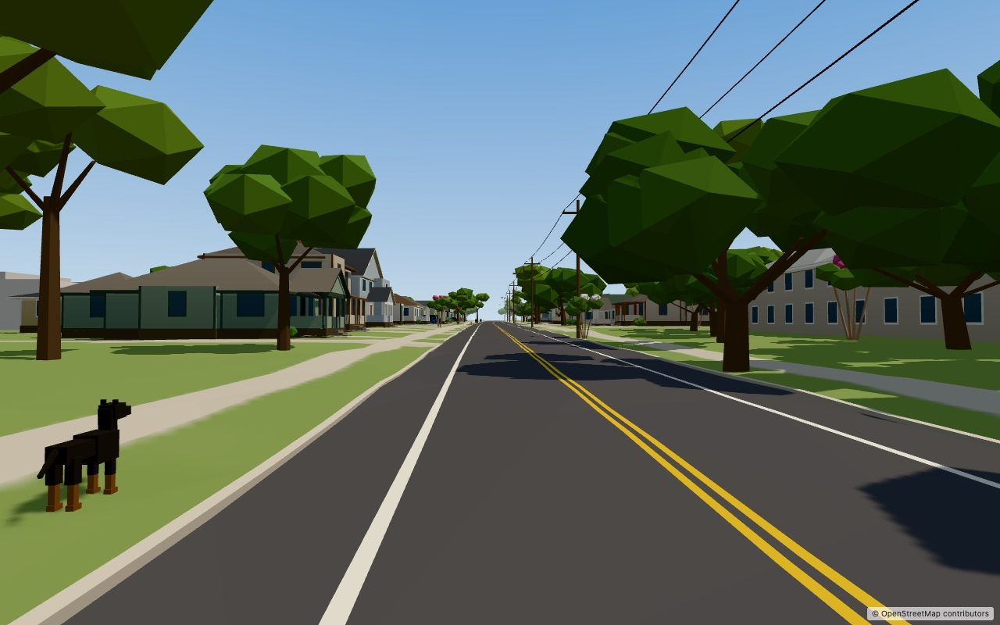
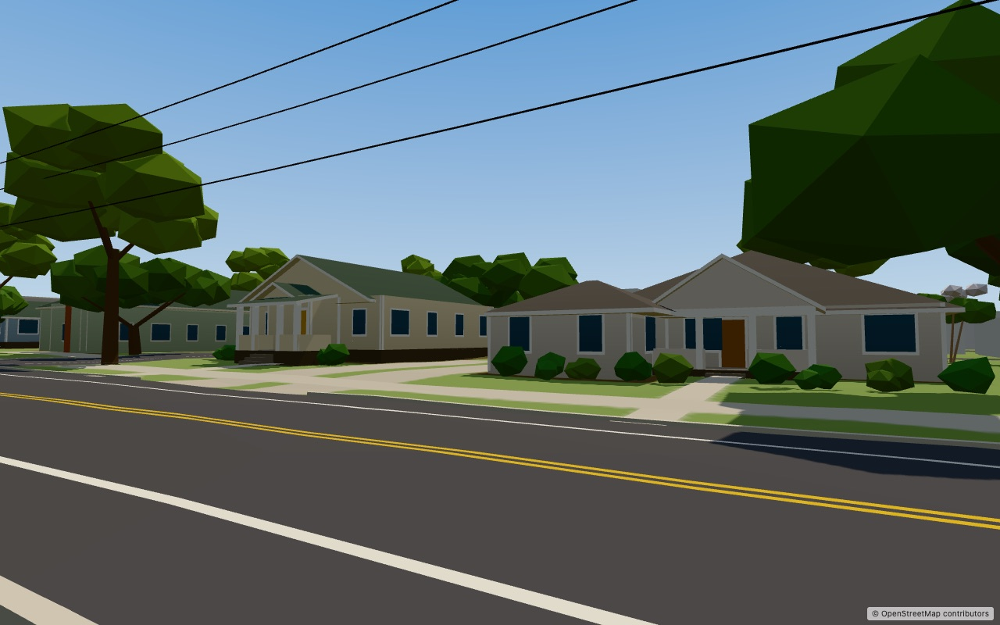
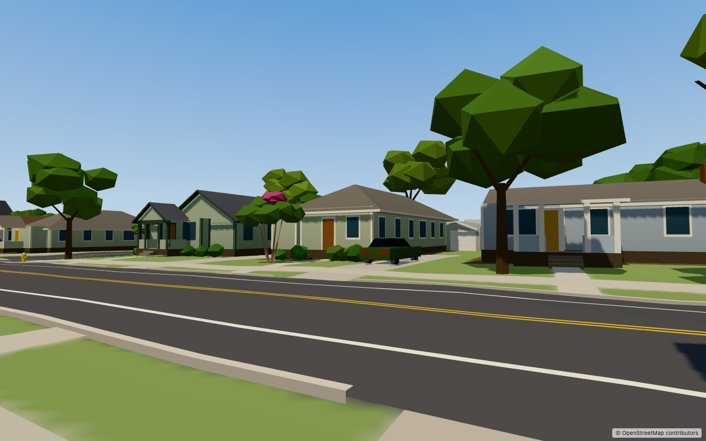
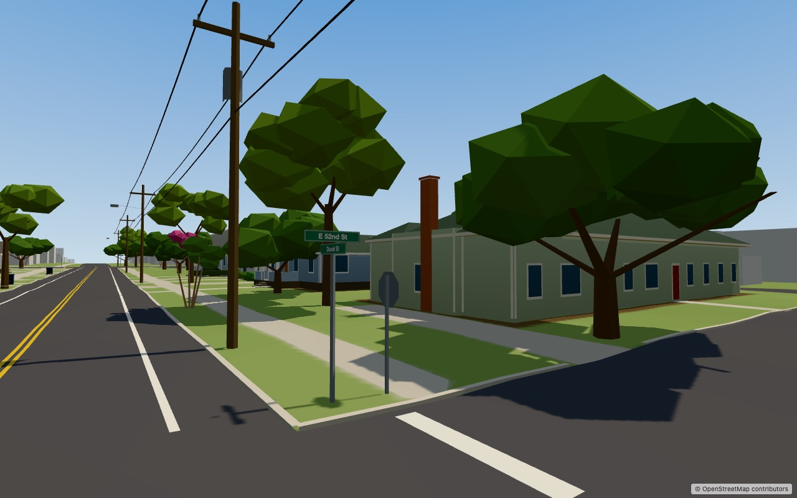

# Art direction (Step 5)

Test block: **Duval St from 51st to 53rd, both sides** (teleport "Art block", or `/?at=art-block`).
Everything outside the dressed area is still gray boxes until Step 7 widens it.



## The look in one paragraph

A sunny late-morning in Hyde Park in summer, as a **stylized low-poly diorama**: faceted, flat-shaded
shapes with **no textures** except the ground and sign text; colors come from a small palette
painted per vertex. Old pier-and-beam bungalows with soft painted siding, white trim, porches
and gray or brown roofs. Big dark live oaks and taller yellow-green pecans, with pink and magenta
crepe myrtles as accents. Wooden utility poles and sagging wires, Austin's green street-name
signs, cracked-free light concrete sidewalks and a warm gray road. The dog is the darkest thing
in the frame, so it always reads against the scene.

## References used

No photos were provided; the block was built from:

- OSM (footprints, City of Austin roof heights, addresses, sidewalks, bike lanes, land use).
- Public listings and records: 5104 Duval is a 1938 bungalow; Hyde Park Animal Clinic at 404 E 51st;
  Bruning Lofts (5100 Bruning Ave) is a 2-story 1977 apartment building; 5300–5304 Duval are 1-story
  units; 501 E 53rd is a 1980 restaurant building.
- What's typical of the area: 1920s–50s bungalows on piers, live oak / pecan / cedar elm / crepe myrtle
  canopy, overhead utility lines, Austin street-sign style.

**Guesses to verify on the street** (fix in `tools/map/overrides.json` / `dress.py` tunables):

- Utility poles on the **east** side of Duval (`POLE_SIDE`).
- Traffic signals at 51st & Duval. Stop signs on 52nd and 53rd at Duval.
- Hydrant color (yellow), house colors, roof types, porches and tree positions: all procedural.
  Real values per house go in `overrides.json`.

## Rules

| Topic | Rule |
| --- | --- |
| Shading | Flat-shaded (one normal per face), vertex colors, `MeshLambertMaterial`. No normal maps or PBR. |
| Color | Palette lives in `src/config/mapStyle.ts` (`MAP_STYLE.dress`), written as sRGB hex. Builders convert to **linear** (three.js treats vertex colors as linear; skipping this washes everything out). |
| Light | Warm sun from the south-east, ~58° high; blue sky fill with warm green ground bounce; gradient sky dome; fog fades to the horizon color; neutral tone mapping. All in `TUNING.lighting` and the lil-gui panel. |
| Fake AO | Walls darken toward the ground, foliage blobs are darker underneath, pier skirting is dark. No post-processing. |
| Ground | Lawns and beds are painted into the tile texture with soft mottling. Hard surfaces (road, sidewalk, driveway, walk, parking) are crisp geometry **cut along the ground mesh's triangles**, so they lie exactly on the terrain. Lane markings are draped the same way. |
| Scale | Real meters. Houses come from real footprints and City of Austin heights (roof peak). Bungalow walls are ≥ 2.6 m floor to eave, piers 0.65 m. |
| Text | Real street names on the signs ("Duval St", "E 52nd St"), shop names from OSM; one small text atlas per tile. |
| Budgets | Keep a house ≤ ~500 triangles (measured: avg 254, max 373), a tree ≤ ~400 (oak 352, pecan 256, myrtle 292, elm 216), a car ~200. Dressed tile ≤ ~25k structure triangles (measured max 18.5k). Whole frame in the block: ~235k triangles (shadow pass included), ~37 draw calls (budget 600k / 150). |

## How it's built

```text
tools/map/dress.py      WHAT goes WHERE (offline, deterministic):
                        building kind (house/garage/shop/apts), front direction, door, porch, roof type,
                        driveways/walks/beds (ground layers), trees, shrubs, poles + wires, hydrants,
                        carts, cars, signs, stop signs, signals, curbs, lane markings
tools/map/dress_area.geojson   the dressed area (lat/lon, editable; Step 7 = the whole map)
tools/map/overrides.json       per-building corrections by OSM id (colors, roof, porch, kind, sign)
src/world/map/dress/    HOW it looks (in the tile worker):
  houses.ts             walls from the exact footprint, roofs from a rectangle decomposition
                        (hip/gable per rectangle, shared eave → cross-gabled bungalows), windows,
                        doors, porches, chimneys, shop fronts, parapets
  props.ts              trees, shrubs, poles, wires, hydrants, carts, cars, stop signs, signals, curbs
  signs.ts              text atlas + sign quads
src/config/mapStyle.ts  palette (no pipeline re-run needed)
```

Per tile, the dressed parts add **no extra draw calls** for houses and props: they merge into the
tile's building mesh. One decal mesh holds surfaces, markings and wires (no shadows), plus one
sign mesh. Collision: each building's exact footprint, porches, tree trunks, poles, cars, carts,
hydrants and sign posts block the dog but not the camera. Shrubs don't block anything (a dog
pushes through them).

## Iterating

- `npm run shots`: fixed camera views of the block → `tools/shots/out/` (`--only=east-side,aerial`,
  `--out=dir`, `--webkit`). Compare before and after any art change.
- Colors and light: edit `mapStyle.ts` / `TUNING.lighting`, or use the lil-gui color pickers (backtick).
- Layout: edit `dress.py` tunables / `overrides.json` / `dress_area.geojson`, then `npm run map:build`.

## Screenshots (end of Step 5)

| | |
| --- | --- |
|  |  |
|  |  |
|  |  |
