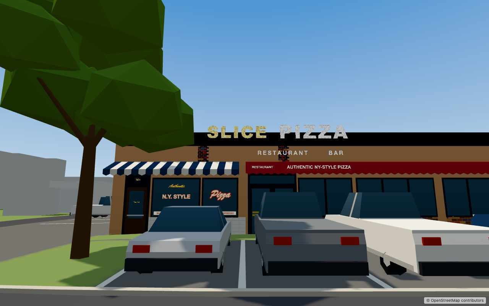
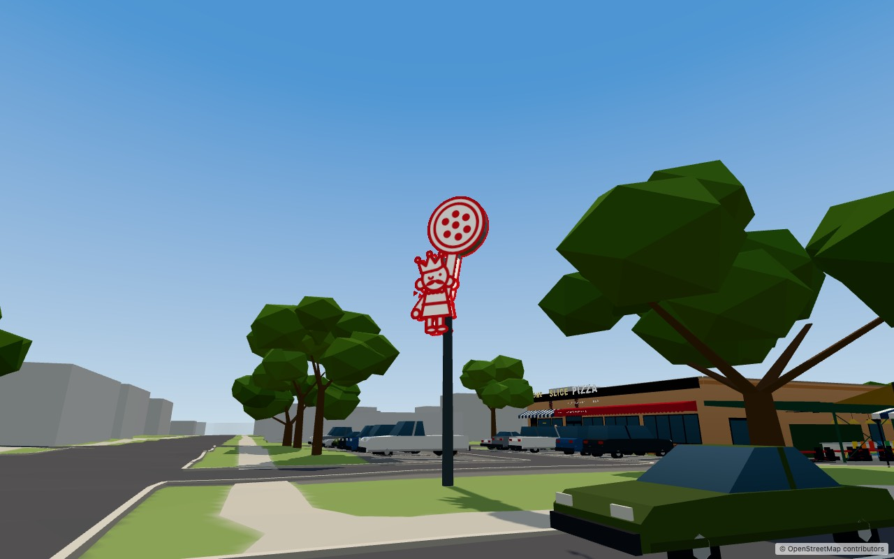
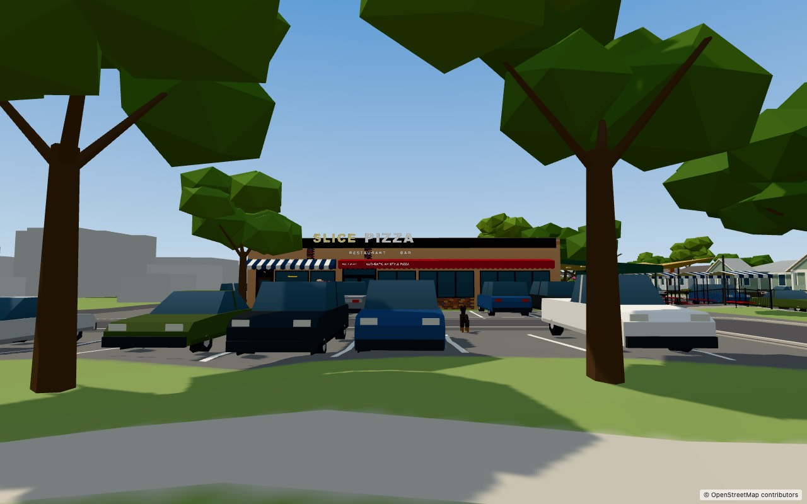
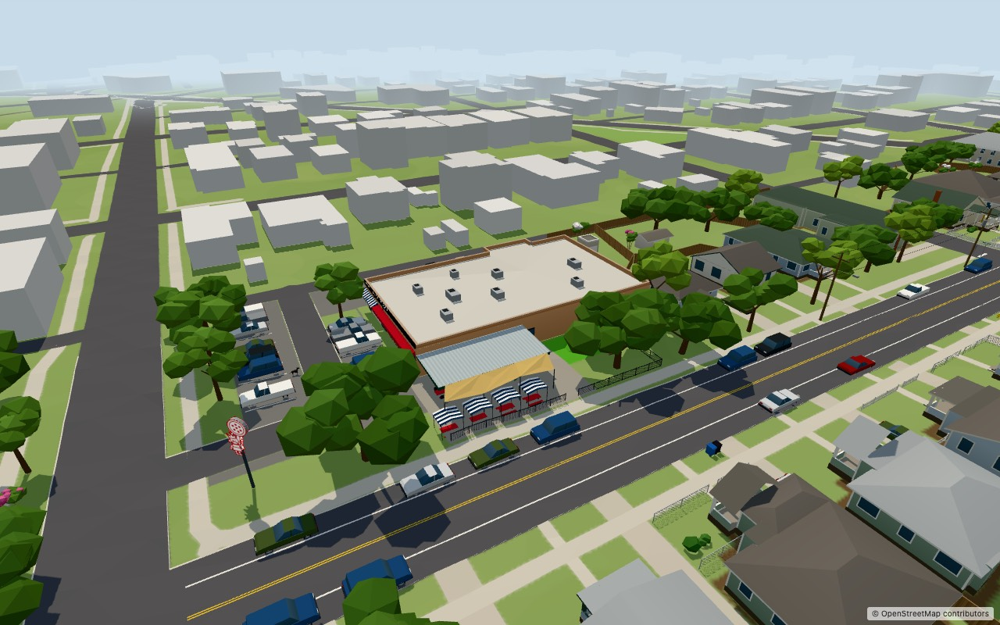
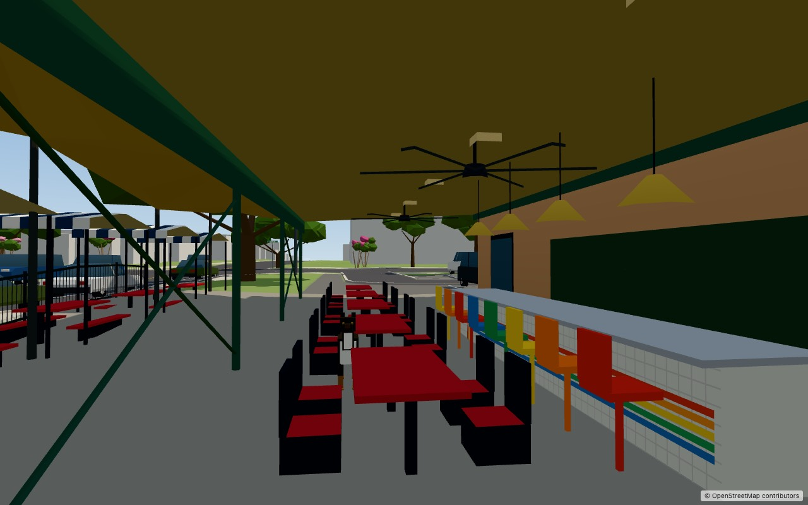
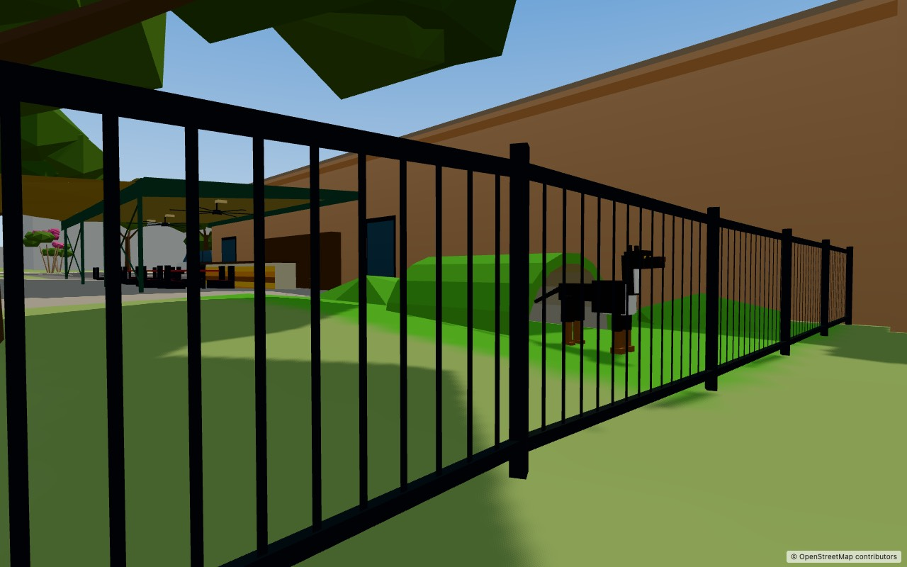
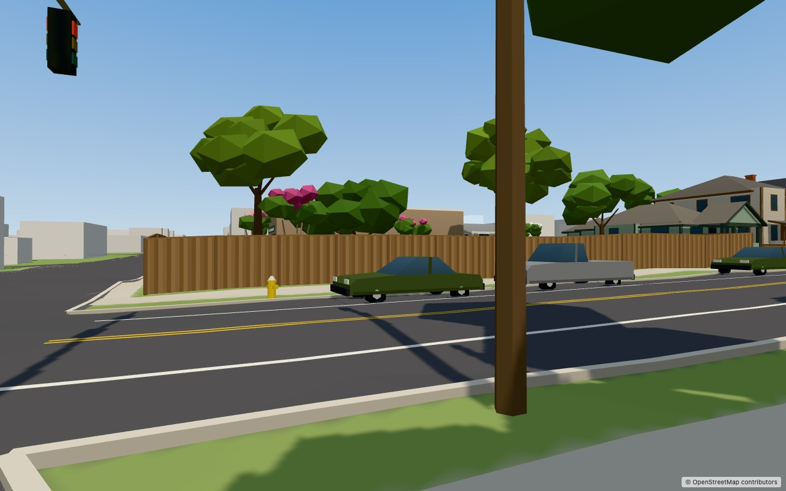
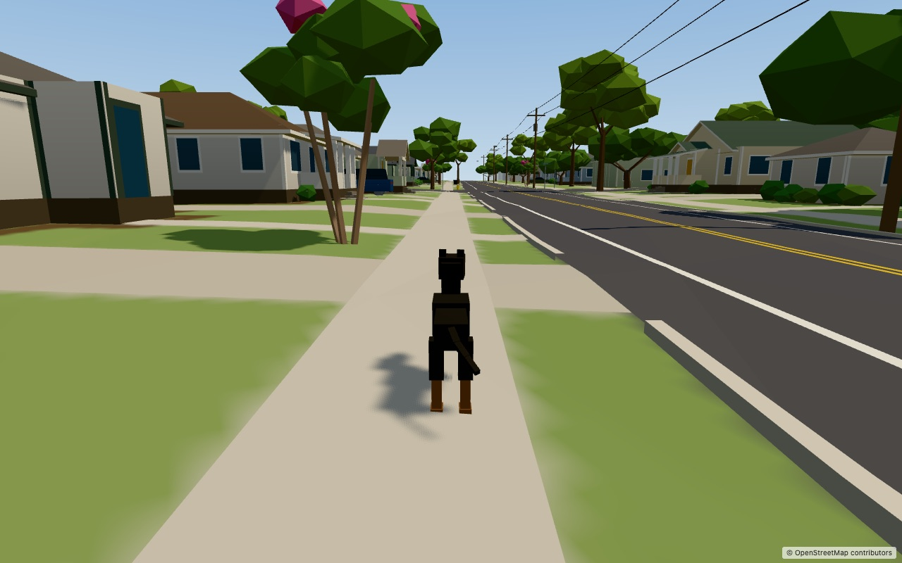
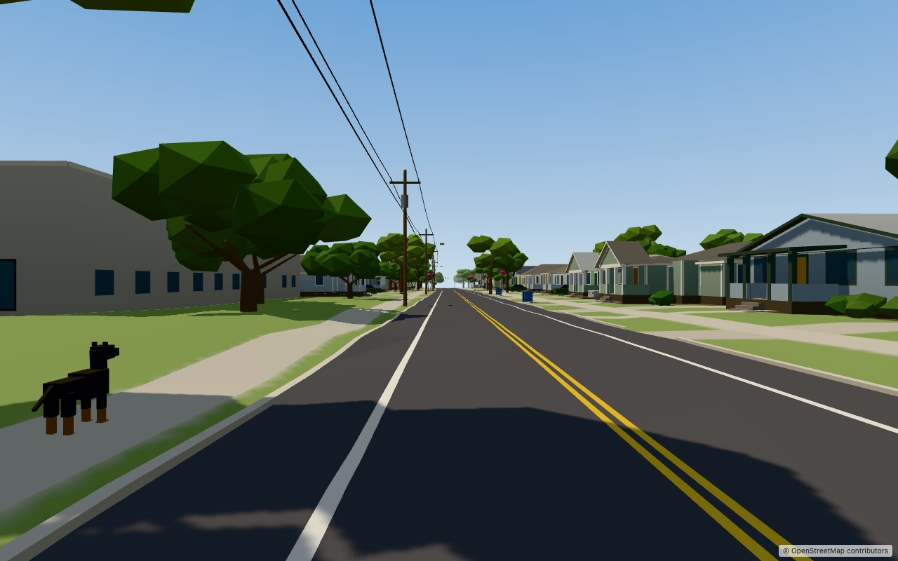
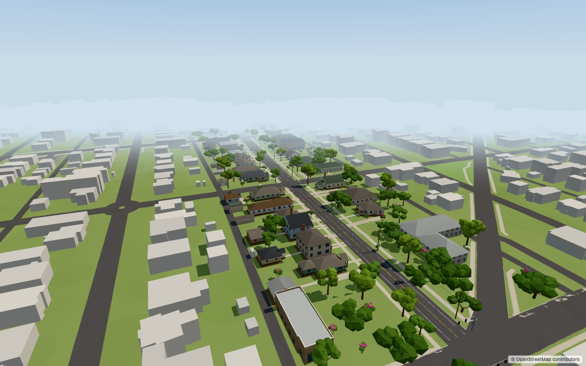

# Art direction (Step 5)

Test block: **Duval St from 51st to 53rd, both sides** (teleport "Art block", or `/?at=art-block`).
Everything outside the dressed area is still gray boxes until Step 7 widens it.


## The look in one paragraph

A sunny late-morning in Hyde Park in summer, as a **stylized low-poly diorama**: faceted, flat-shaded
shapes with **no textures** except the ground and sign text; colors come from a small palette
painted per vertex. Old pier-and-beam bungalows with soft painted siding, white trim, porches
and gray or brown roofs. Big dark live oaks and taller yellow-green pecans, with pink and magenta
crepe myrtles as accents. Wooden utility poles and sagging wires, Austin's green street-name
signs, cracked-free light concrete sidewalks and a warm gray road. The dog is the darkest thing
in the frame, so it always reads against the scene.

## References used

No photos were provided; the block was built from:

- OSM (footprints, City of Austin roof heights, addresses, sidewalks, bike lanes, land use).
- Public listings and records: 5104 Duval is a 1938 bungalow; Hyde Park Animal Clinic at 404 E 51st;
  Bruning Lofts (5100 Bruning Ave) is a 2-story 1977 apartment building; 5300–5304 Duval are 1-story
  units; 501 E 53rd is a 1980 restaurant building.
- What's typical of the area: 1920s–50s bungalows on piers, live oak / pecan / cedar elm / crepe myrtle
  canopy, overhead utility lines, Austin street-sign style.

**Guesses to verify on the street** (fix in `tools/map/overrides.json` / `dress.py` tunables):

- Cars parked along both curbs of Duval (seen on the aerial); the white edge line now marks the parking
  lane (OSM tags bike lanes there, the imagery shows parked cars).
- Utility poles on the **east** side of Duval (`POLE_SIDE`). The aerials suggest the lines mostly run
  down the alleys behind the houses (e.g. the alley east of Home Slice), not along Duval.
- Traffic signals at 51st & Duval. Stop signs on 52nd and 53rd at Duval.
- Hydrant color (yellow), house colors, roof types, porches and tree positions: all procedural.
  Real values per house go in `overrides.json`.

## Hero locations: nail a few places

Getting every lot exactly right doesn't scale; a handful of places a local recognizes instantly
does. A hero location is an OSM building plus a **site plan authored in the building's own frame**
from aerial imagery and photos:

- `tools/map/landmarks.py` decides WHAT goes WHERE: ground (lot, walk, patio slab, turf), stall
  lines, parked cars, hand-placed trees, fences, and the frame (origin = the storefront's west corner,
  `a` along the storefront, `b` out of it) handed to the game. Random trees/props stay out of the site.
- `src/world/map/dress/landmarks/` builds the building and its fixtures in that frame.
- Measure, don't guess: `npm run map:site -- --at=home-slice` draws the generated site (footprints,
  ground, stalls, cars, trees, fences, and the landmark's 2 m `a`/`b` grid) over the aerial (Esri World
  Imagery, ~6 cm/px at zoom 21, cached in `tools/map/cache/imagery/`, reference only, never shipped)
  → `tools/map/out/site_*.jpg`. A photo with a known-size element (a double door ≈ 2.1 m) gives
  heights and widths.

### Home Slice Pizza (501 E 53rd, SE corner of Duval & 53rd)





| Part | What it's based on |
| --- | --- |
| Building | OSM footprint (former Bair's office supply, brick kept intact). Roof deck 4.15 m, parapet to 4.75 m; OSM's 6.78 m is the rooftop units. Light membrane roof with HVAC units (aerial). |
| Storefront (faces north, onto the lot) | Press photo (Patch / CultureMap, 2018), measured with the doors as scale: take-out door with "501" + two painted windows (*Authentic N.Y. STYLE*, *Pizza*, menu strips) on white subway tile under a blue/white striped awning; black double doors with brass push bars and windows on multicolor brick under a red box awning (RESTAURANT · AUTHENTIC NY-STYLE PIZZA); multicolor brick panels; "RESTAURANT BAR" in white letters; black sign band with **sequined HOME SLICE (gold) PIZZA (silver)** letters over the east half. |
| Lot | Aerial: walk along the storefront, 6 nose-in stalls + a tree planter, the 6 m aisle (OSM service road), 9 stalls facing the island along 53rd (elms, oak), 8 stalls along the east wall by the alley. |
| Queen of Pies pole sign | Photo (Austinot, 2018): the crowned, pig-tailed, mustachioed pizza chef raising a pepperoni pie, white cut-out with red outline, on a tall gray pole with a gray cabinet and pie drum behind. Painted into the sign atlas with canvas paths (`signs.ts`, `drawQueen`). **Position is a guess**: the lot's corner at Duval & 53rd, in front of the big live oak (a big tree stands right behind it in the photo), facing the intersection. |
| Patio (west, facing Duval) | Aerial + press + photo ("NYC sidewalk scaffolding"): corrugated metal shed roof on green scaffold pipes over the outdoor bar (white grid tile with '70s rainbow stripes that turn down to the floor, stainless top, multicolor bar chairs, brass dome pendants), giant ceiling fans and tables; tan shade sails; blue/white striped canopies over red picnic tables along a black metal fence; turf kids' area ("hills and tunnels") with mounds and a crawl tunnel the dog fits through; big live oaks. |

**Guesses** (the photo doesn't show them): the storefront west of the main windows (continued
windows + red awning; the awning text after "PIZZA" is cut off in the photo, so it's left blank),
the west wall's doors, table counts and colors under the shed, the fence type, the canopy tables.

| | |
| --- | --- |
|  |  |
|  |  |

### Hyde Park Animal Clinic (NW corner of Duval & 51st)



Tall (2.1 m) wood privacy fence around its lot (the clinic plus its big wooded side yard toward Duval,
which it claims up to 1.5 m short of the house north of the yard); the clinic's front on 51st stays open.

## Rules

| Topic | Rule |
| --- | --- |
| Shading | Flat-shaded (one normal per face), vertex colors, `MeshLambertMaterial`. No normal maps or PBR. |
| Color | Palette lives in `src/config/mapStyle.ts` (`MAP_STYLE.dress`), written as sRGB hex. Builders convert to **linear** (three.js treats vertex colors as linear; skipping this washes everything out). |
| Light | Warm sun from the south-east, ~58° high; blue sky fill (hemisphere 1.8: three.js divides it by π, so shaded walls need a strong fill to keep their colors) with warm green ground bounce; gradient sky dome; fog fades to the horizon color; neutral tone mapping. All in `TUNING.lighting` and the lil-gui panel. |
| Fake AO | Walls darken toward the ground, foliage blobs are darker underneath, pier skirting is dark. No post-processing. |
| Ground | Lawns and beds are painted into the tile texture with soft mottling. Hard surfaces (road, sidewalk, driveway, walk, parking) are crisp geometry **cut along the ground mesh's triangles**, so they lie exactly on the terrain. Lane markings are draped the same way. |
| Scale | Real meters. Houses come from real footprints and City of Austin heights (roof peak). Bungalow walls are ≥ 2.6 m floor to eave, piers 0.65 m. |
| Text | Real street names on the signs ("Duval St", "E 52nd St"), shop names from OSM; one small text atlas per tile. |
| Fences | Follow **approximate lots** (`dress.compute_lots`: OSM has no parcels, so land is split by nearest building, garages join their house's lot, lot lines straightened as a coverage so neighbors share them exactly). Front yards (38% of houses that reach the street): picket, chain link, black iron or horizontal cedar, a closed loop along the lot's front and sides back to the house walls, with a gate at the walk and a gap at the driveway. Back yards: 1.85 m cedar privacy fence on lot lines shared with neighbors (85%) behind the house fronts, and along alleys. They block the dog, not the camera. |
| Parked cars | Parallel along both curbs of the dressed street (60% of slots), never within ~6.5 m of an intersection, at a curb cut, or 4.6 m (15 ft) of a hydrant; facing traffic on their side. Cars in driveways and in landmark lots too. |
| Budgets | Keep a house ≤ ~500 triangles (measured: avg 254, max 373), a tree ≤ ~400 (oak 352, pecan 256, myrtle 292, elm 216), a car ~200. Dressed tile ≤ ~25k structure triangles (measured max 18.5k). Whole frame in the block: ~235k triangles (shadow pass included), ~37 draw calls (budget 600k / 150). A hero location ≤ ~12k triangles (Home Slice: see the perf report). |

## How it's built

```text
tools/map/dress.py      WHAT goes WHERE (offline, deterministic):
                        building kind (house/garage/shop/apts), front direction, door, porch, roof type,
                        driveways/walks/beds (ground layers), trees, shrubs, poles + wires, hydrants,
                        carts, cars, signs, stop signs, signals, curbs, lane markings
tools/map/dress_area.geojson   the dressed area (lat/lon, editable; Step 7 = the whole map)
tools/map/overrides.json       per-building corrections by OSM id (colors, roof, porch, kind, sign)
tools/map/landmarks.py         hero locations: site plans in the building's frame (lot, patio, cars, trees, fences)
src/world/map/dress/    HOW it looks (in the tile worker):
  houses.ts             walls from the exact footprint, roofs from a rectangle decomposition
                        (hip/gable per rectangle, shared eave → cross-gabled bungalows), windows,
                        doors, porches, chimneys, shop fronts, parapets
  props.ts              trees, shrubs, poles, wires, hydrants, carts, cars, stop signs, signals, curbs
  fences.ts             picket / chain link / iron / cedar / privacy fences along polylines
  signs.ts              text atlas (shelf-packed; cut-out letters, script, sequins) + sign quads
  landmarks/            hand-made hero buildings (homeSlice.ts)
src/config/mapStyle.ts  palette (no pipeline re-run needed)
```

Per tile, the dressed parts add **no extra draw calls** for houses and props: they merge into the
tile's building mesh. One decal mesh holds surfaces, markings and wires (no shadows), plus one
sign mesh. Collision: each building's exact footprint, porches, tree trunks, poles, cars, carts,
hydrants and sign posts block the dog but not the camera. Shrubs don't block anything (a dog
pushes through them).

## Iterating

- `npm run shots`: fixed camera views of the block → `tools/shots/out/` (`--only=east-side,aerial`,
  `--out=dir`, `--webkit`). Compare before and after any art change.
- Colors and light: edit `mapStyle.ts` / `TUNING.lighting`, or use the lil-gui color pickers (backtick).
- Layout: edit `dress.py` tunables / `overrides.json` / `dress_area.geojson`, then `npm run map:build`.

## Screenshots (end of Step 5)

| | |
| --- | --- |
|  |  |
|  |  |
|  |  |
